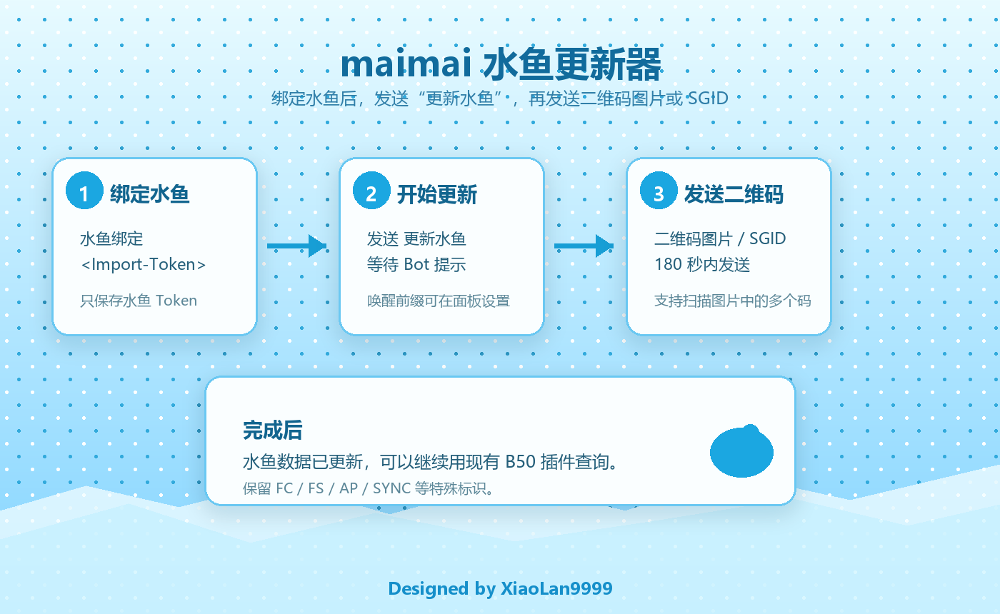

# AstrBot maimai 水鱼更新器

这是一个 AstrBot 插件，用舞萌 DX 官方玩家二维码图片或 `SGWCMAID...` 文本和水鱼 Import-Token，把完整成绩同步到水鱼查分器。



## 更新日志

见 [CHANGELOG.md](CHANGELOG.md)。

## 功能

- `maimaitoken <Import-Token>` / `水鱼绑定 <Import-Token>` / `绑定水鱼 <Import-Token>`：保存水鱼 Import-Token。
- `maimaiupdate` / `更新水鱼` / `水鱼更新` / `更新b50`：开始更新，按提示发送二维码图片或 SGID。
- `maimaiclear 确认清空` / `清空水鱼 确认清空` / `清空b50 确认清空`：向水鱼发送清空成绩请求。
- `maimaistatus` / `水鱼状态`：查看绑定状态、最近同步结果和命令触发方式。
- `maimaiunbind` / `水鱼解绑`：删除当前用户保存的水鱼 Token 和本地状态。

绑定一次水鱼后，每次更新先发送更新命令，再在同一会话的 180 秒内发送官方玩家二维码图片或本次 SGID。等待期间发送 `取消更新` 可结束；重新发送更新命令会重新计时。等待时间可在面板修改。

同一张图片中的二维码会全部扫描，聊天消息含多张图片时也会逐张扫描。无 SGID 时会提示重新发送；有多个不同 SGID 时需要单独发送目标玩家的二维码。重复出现的同一 SGID 只处理一次。

原来的 `更新水鱼 SGWCMAID...` 单条命令仍然可用，也可将更新命令和二维码图片放在同一条消息中。

## 命令触发

默认开启 `require_command_prefix`，插件只响应 AstrBot 标准命令触发。实际前缀取决于 Bot 配置，例如：

```text
/水鱼状态
/水鱼绑定 <Import-Token>
/更新水鱼
[随后发送二维码图片或 SGWCMAID...]
```

如果在面板关闭 `require_command_prefix`，本插件命令可以不带 Bot 唤醒前缀直接发送：

```text
水鱼状态
水鱼绑定 <Import-Token>
绑定水鱼 <Import-Token>
更新水鱼
[随后发送二维码图片或 SGWCMAID...]
清空b50 确认清空
水鱼解绑
```

唤醒前缀只影响开始更新的命令；等待中的二维码或 SGID 无需带前缀。没有开始更新时，单独发送二维码或 SGID 不会触发。

## 当前数据链路

插件会通过本次 SGID 读取完整官方成绩字段，并写入水鱼 Import-Token 对应账号。

更新后的水鱼数据会保留 FC / FS / AP / SYNC 等特殊标识；不会用基础成绩链路猜测或补全这些标识。

## 运行环境

- Python `>=3.10,<4.0`
- AstrBot `>=4.5.2`
- 依赖见 `requirements.txt`

Windows x64 使用本地成绩链路；Linux x64 需已有配套运行环境。安卓 Ubuntu 容器、ARM64 等设备使用同一个插件包，通过远程成绩服务更新，保留 FC / FS / AP / SYNC 标识。

### 安卓 Ubuntu 容器

适配对象包括 [AstrBot-Android-App](https://github.com/zz6zz666/AstrBot-Android-App) 的 Ubuntu 容器。手机端只负责接收消息、识别二维码和导入水鱼，完整官方成绩由自行部署的成绩服务读取。

在插件面板填写 `remote_score_url`（远程成绩服务根地址）和 `remote_score_token`（访问密钥）。未配置时插件会先提示管理员配置，再开始接收更新凭据。水鱼 Import-Token 仍使用水鱼绑定命令单独绑定。

这不是安卓本机独立运行官方链路：需要一台已能正常读取完整成绩的 Windows x64 或 Linux x64 设备运行配套服务，详见 [远程成绩服务](docs/remote-score-service.md)。不需要按系统下载不同版本的插件。

图片识别使用 Pillow 与 zxing-cpp；不需要额外安装系统级扫码工具。图片最大 20 MB、2400 万像素。

如果依赖安装失败，完整关闭 AstrBot Launcher 和相关 Python 进程后重新安装插件依赖。
